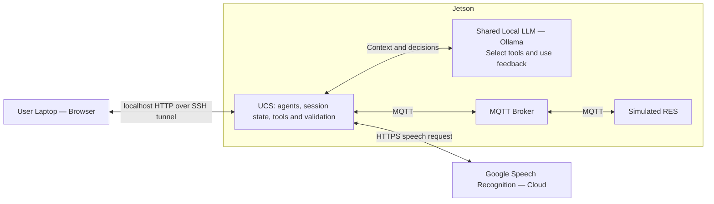
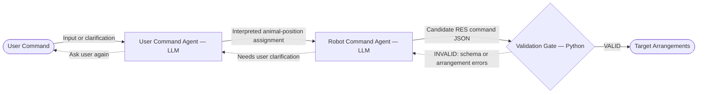

# System design

This document specifies the implemented target system. The [controlled composition](controlled-ucs.md) exercises the graph routes with deterministic role and RES substitutes. The [integrated composition](integrated-workflow.md) uses live Ollama roles, real MQTT and a separate simulated RES, while [speech input](speech-input.md) returns editable text for explicit submission. Passing controlled tests does not establish live-model quality.

## Scope and roles

A Target arrangement assigns the elephant (`E`), bear (`B`), and hippo (`H`) exactly once to distinct `front_left`, `front_center`, and `front_right` positions. Support all six permutations, including requests beyond size ordering.

- **User Command Agent:** interpret requests, infer unspecified destinations when all supported, unambiguous constraints determine exactly one valid complete arrangement, clarify unresolved information with the user, and pass the complete assignment with the original request and replies.
- **Robot Command Agent:** construct candidate RES command JSON from that assignment, use validation feedback to repair generation errors, or request user clarification through the User Command Agent.
- **Validation Gate:** Python checks the complete command schema, arrangement rules, unchanged application metadata, and equality with the interpreted assignment. This safety-oriented design blocks malformed or invalid commands; it does not establish correct interpretation of the original request or physical robot safety.

LangGraph coordinates the roles. One configurable local LLM served by Ollama receives separate role instructions in sequential calls; a distinct role does not require a separately loaded model. This composition is deployed on Jetson with `ministral-3:3b`, but model reliability and full acceptance remain qualified.

## System architecture

The browser submits requests, answers questions, and displays progress and results. The application validates targets and sends them automatically to the Simulated RES. Public topics are `robot/command`, `robot/status`, and `robot/result`; credentials and broker access stay server-side. The verified deployment exposes only Jetson loopback services and reaches the UCS from the laptop through an SSH tunnel. It is not a public HTTPS service.

## Agentic workflow

Validation failure returns the candidate and feedback to the Robot Command Agent with the unchanged interpreted assignment and request evidence. Permit two repair attempts after the initial candidate, configurable with `max_repairs`. Every candidate passes the same Python gate. Repairs cannot choose different positions or overwrite system metadata. If resolving a conflict requires revised intent, the Robot Command Agent selects `ASK_USER`; the User Command Agent asks a question and waits for an actual reply. A revised assignment starts a new repair budget, while the overall agent-call and clarification budgets persist.

D02 — Negative constraints: negative instructions are valid arrangement constraints. When positive assignments, negative constraints and the one-to-one arrangement rules leave exactly one valid complete arrangement, UCA may infer and hand it off. With no valid arrangement, explain the conflict and ask which instruction should change. With multiple valid arrangements, ask for missing information. Never ignore a negative constraint or choose arbitrarily.

D03 — Unique arrangement inference: UCA may infer unspecified destinations when all supported, unambiguous constraints leave exactly one valid complete arrangement. A consistent negative constraint does not block inference. Unsupported entities, ambiguous corrections or pronouns, contradictory evidence and multiple valid arrangements require clarification. Later actual named corrections update the evidence while retaining unmodified constraints. Complete explicit duplicate destinations still follow the existing RCA clarification route; this does not authorize inference or dispatch of an invalid arrangement. Explicit left-to-right and right-to-left lists specify positions in that order.

Interpretation belongs to the live model. The shared workflow and complete Python validation gate neither interpret negative language nor fill destinations. The controlled Python role intentionally supports a narrower explicit-pair grammar and remaining-slot inference from two distinct pairs; negative wording requires an explicit-pair restatement there. No negative-language parser or model-failure fallback is introduced.

An acknowledgement adds no destinations. While information remains unresolved, the User Command Agent asks for it again. After completion, stale clarification replies are rejected before invoking either agent and must not be retried automatically as new requests. A fresh request starts a new context; these guards do not semantically classify arbitrary new-request text as an acknowledgement.

Python generates the message identifier and timestamp once per interpreted assignment. The Robot Command Agent includes that metadata in its candidate. Application code sends the exact validated command without regenerating it. Exhausted repairs, malformed role actions, and technical tool/model failures stop without dispatch; they do not ask the user to fix internal errors.

The successful agentic output is one Target arrangement. Application code then sends the exact validated target automatically, without a separate confirmation step. Execution status and results belong to the wider system workflow.

## Application rules

- Do not dispatch while the request is unsupported, ambiguous, incomplete, or invalid.
- Bind validation and dispatch to the current request revision and session; stale candidates cannot execute.
- Permit one Active command per browser session and prevent repeat dispatch for duplicate calls or resumptions. Validate and correlate RES messages by `message_id`.
- Never automatically resend after uncertain delivery or missing results. Preserve unresolved command state and define late-result reconciliation.
- Bound agent steps and clarification turns; wait for real user replies. Exhaustion or cancellation before dispatch ends without a command. Cancellation after dispatch does not establish that execution stopped.
- Simulated completion uses execution `COMPLETED` and verification `NOT_RUN`. It does not prove physical placement or visual verification.

## Speech and evaluation

Speech recording is user-initiated. UCS sends recorded audio to Google over HTTPS and returns editable text; the user must submit it before interpretation. Typed fallback remains available and raw audio is not persisted by default. The localhost origin used through the SSH tunnel is a browser secure context, but real deployed microphone/Google acceptance and the required visible processing disclosure remain outstanding.

Evaluate intent fidelity across all six arrangements, useful clarification, invalid-input handling, observable action selection and tool-feedback adaptation, and latency. Separate real-model measurements from deterministic validation and delivery tests. Include stale/duplicate requests, unavailable dependencies, and uncertain delivery. Agent labels and diagram loops alone are not evidence of agentic behaviour.

The implementation uses strict action schemas and configurable limits: 12 agent calls, 3 clarification questions, 2 repair attempts after the initial candidate, 20 seconds per agent call, and 30 seconds for execution. Durable SQLite state and receive-only late-result reconciliation are available when explicitly configured; the default development harness remains in memory. Evaluation agreement and broad live-model reliability remain incomplete. Physical control, ROS and perception remain outside the baseline. A separately evaluated fine-tuned candidate is an extension beyond that baseline, remains experimental, and is not the deployed default.
